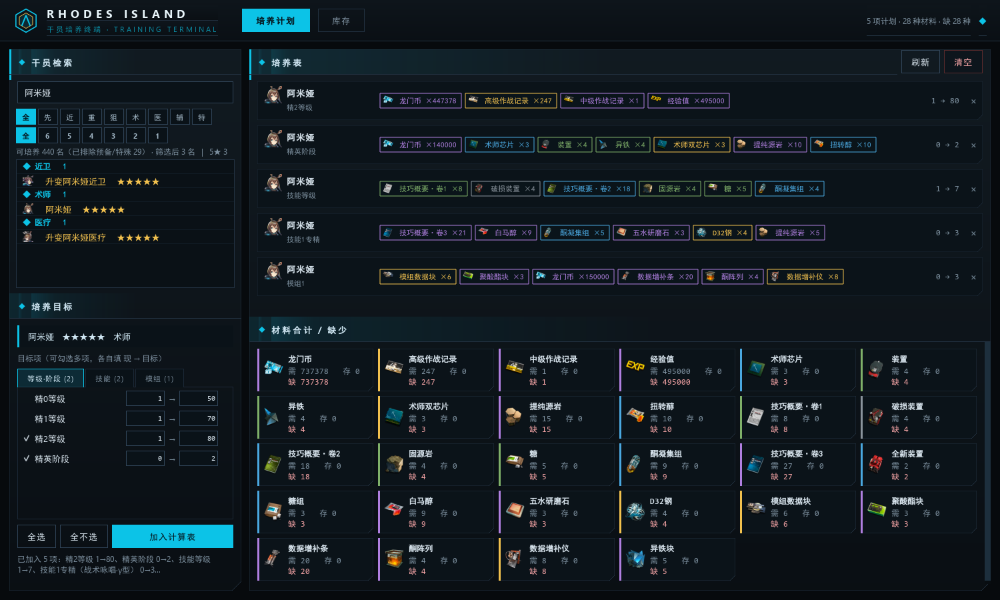

# 明日方舟 · 干员培养终端

一个 **离线可用的明日方舟培养计算器**（Windows 桌面程序，PySide6 原生窗口）。
计算逻辑从 [cn.ark-nights.com](https://cn.ark-nights.com/table) 的前端 bundle **提取并移植**，数据存 SQLite，
支持库存/练度导入（penguin-statistics 仓库、MAA 干员识别）。



## 功能

| 模块 | 说明 |
| --- | --- |
| 干员检索 | 469 名干员 → 过滤掉预备干员/特殊模式专用后 **440 名可培养**；按**职业分组 + 星级排序**，顶部职业/星级筛选，显示总数与星级分布 |
| 培养目标 | 每个干员可**同时勾选多项**：精0/1/2等级、精英阶段、技能等级、技能1/2/3专精、模组1/2/3；等级与阶段各自填「现 → 目标」，支持区间累加（如精英 0→2、技能 1→7） |
| 培养表 | **「全部」+ 每个干员一个标签页**；每行显示升级项目、材料 chip、现→目标，右侧 `×` 删除 |
| 材料合计 / 缺少 | 跟随当前标签页实时汇总：需 / 存 / 缺 / 可合成（用库存配方算） |
| 库存 | 98 种材料表格 + 搜索 + 数量编辑，保存写回 SQLite |
| 导入 | 库存与干员练度（JSON/CSV/TXT/剪贴板），见下 |

## 算法（移植，不是重新推导）

| 站点模块 | 内容 | 实现 |
| --- | --- | --- |
| `2lXy.a` | `levelCost(rarity, phase, cur, target)` | `app/calc.py: level_cost()` |
| `v1ni` | `maxLevel` / `upgradeCoinRequirement` / `upgradeExpRequirement` | `data/levelTables.json` |
| `Ovxt` | 龙门币 `G-4-1`、经验值 `EO-4-1`、作战记录 2000/1000/400/200 | `data/ovxt.json` |
| 干员对象 | `elites[].materials`、`skills[]`、`master_skills[].upgrades[]`、`equipments[][]` | `app/arknights.db` 四张明细表 |

```
coin = Σ upgradeCoinRequirement[phase][cur-1 … target-2]
exp  = Σ upgradeExpRequirement[phase][cur-1 … target-2]
t    = 200 × ceil(exp / 200)  → 按 2000/1000/400/200 拆作战记录，并把 exp 记为「经验值」
```

### 校验（与站点逐项一致）

| 用例 | 结果 |
| --- | --- |
| 阿米娅 · 精2等级 1→80 | 龙门币 **447,378** / 经验 **495,000** / 高级作战记录 **247** / 中级 **1** |
| 阿米娅 · 精英阶段 0→1 | 龙门币 **20,000** / 术师芯片 3 / 装置 4 / 异铁 4 |
| 能天使 · 精2等级 60→90 | 龙门币 573,387 / 高级作战记录 261 / 经验 523,114 |

## 运行

### 方式一：直接跑源码

```bat
pip install PySide6 Pillow
python app\app_desktop.py
```

### 方式二：打包成单文件 exe

```bat
pip install pyinstaller
pyinstaller --noconfirm --onefile --noconsole --name 明日方舟培养终端 ^
  --add-data "app\arknights.db;." --add-data "app\icons;icons" ^
  --add-data "data\items_map.json;data" --paths app app\app_desktop.py
```

产物在 `dist\明日方舟培养终端.exe`（约 55 MB，含全部图标与数据库）。

## 导入

| 页签 | 支持格式 |
| --- | --- |
| 库存 | `{"@type":"@penguin-statistics/depot","items":[{"id":"4001","have":664000}]}`、`{"items":{"30012":88}}`、`[{"itemId":"30012","count":88}]`、`名称,数量` |
| 干员列表 | MAA 练度 `[{"id":"char_003_kalts","name":"凯尔希","elite":2,"level":60,"own":true,"skills":[{"level":10,"specializeLevel":3}],"modules":[1,2]}]`、`char_xxx` 或中文名逐行 |

物品 id → 材料名映射来自官方 `item_table.json`（`data/items_map.json`，1599 条）。
导入练度后，选中该干员会**自动预填**现等级/精英阶段/技能/专精/模组，已拥有的干员带 `●` 标记，`我的` 按钮可只看自己有的（切页自动恢复全部）。

## 目录

```
app\
  app_desktop.py    桌面程序（PySide6 自绘 UI）
  calc.py           计算核心（移植自站点）
  importer.py       MAA / penguin-statistics 导入解析
  import_dialog.py  导入对话框
  build_db.py       data\*.json → arknights.db
  arknights.db      SQLite（469 干员 / 98 材料 / 3006 专精 / 1533 模组）
  icons\            材料图 98 张（站点）、干员头像 469 张（PRTS）
data\
  operators.json / allMaterials.json / levelTables.json / ovxt.json / availability.json / items_map.json
tools\              重新抓取数据的说明
docs\               截图
```

## 森空岛登录（一键同步练度）

顶栏 **森空岛** 按钮 → 两种登录方式：

| 方式 | 操作 |
| --- | --- |
| 扫码登录 | 点「生成登录二维码」，用 **森空岛 App** 扫码（60 秒内有效）→ 自动换取 cred/token 并保存 |
| 凭据登录 | 贴入抓包得到的 `cred` + `token` → 保存并读取角色 |

登录后可读取账号下绑定的明日方舟角色，点「同步选中角色的练度」即把：

- 精英阶段 `evolvePhase` → 现精英
- 等级 `level` → 现等级
- 技能等级 `mainSkillLvl` + 专精 `skills[].specializeLevel` → 技能/专精预填
- 模组 `equip[].level` → 模组预填
- 潜能 `potentialRank` → 潜能

写进 `owned` 表，界面里带 `●` 标记，选干员时自动预填「现等级/精英阶段/技能/模组」，勾选目标即可算缺口。

> 说明：森空岛接口**不提供仓库（材料数量）**，实时库存仍需用 MAA / penguin-statistics 导入。
> 凭据保存在 `app/skland_cred.json`（已加入 .gitignore），可随时删除或退出登录失效。

实现参考：[nonebot-plugin-skland](https://github.com/FrostN0v0/nonebot-plugin-skland) 的签名算法
（`hmac_sha256(cred.token, path+query+ts+headers)` → `md5`）。

## 仓库结构

```
app\            桌面程序源码 + SQLite 数据库
  icons\materials\    98 张材料图标
  icons\operators\    469 张干员头像（来自 PRTS）
data\           干员 / 材料 / 等级表 / 物品映射 JSON
tools\          重新抓取数据的说明
docs\           界面截图
```

克隆与运行：

```bat
git clone https://github.com/tiezu2/Arknights-Calculator.git
cd Arknights-Calculator
pip install -r requirements.txt
python app\app_desktop.py
```

> 仓库约 11 MB。国内网络访问 GitHub 受限时可配置代理或使用镜像。

## 数据与版权

- 计算逻辑与干员/材料数据提取自 **cn.ark-nights.com**（V2.23.20 前端 bundle）
- 材料图标来自该站点；干员头像来自 **PRTS 明日方舟 Wiki**
- 明日方舟及相关美术素材版权归 **鹰角网络（Hypergryph）** 所有
- 本仓库代码仅用于个人学习与规划，请勿商用；数据版权归原出处

## License

代码部分：MIT（见 [LICENSE](LICENSE)）。第三方数据/图片不适用 MIT，见上方说明。
